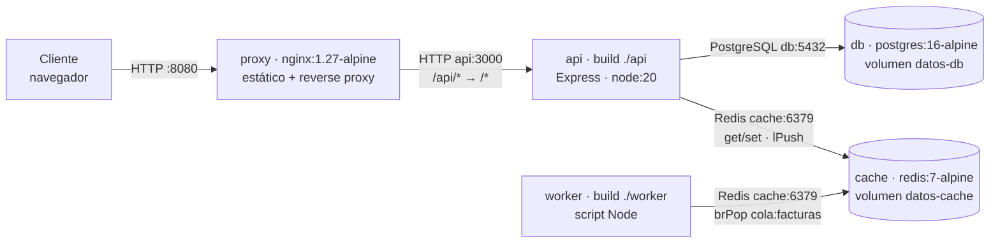
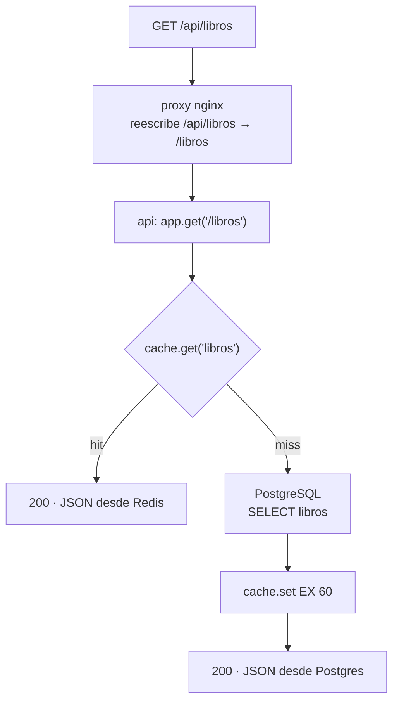
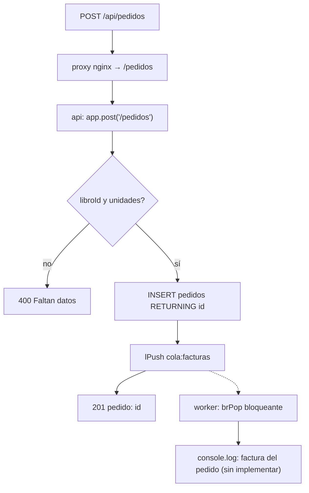

# Arquitectura — tienda-libros

**Modelo:** arquitectura **en 3 capas contenerizada** (presentación / lógica de negocio / datos) **+ caché y cola de tareas asíncrona**, orquestada con Docker Compose. No es una arquitectura de microservicios: hay una única base de datos y un único despliegue conjunto (`docker-compose.yml`).

Documento elaborado a partir de `docker-compose.yml`, `api/src/server.js`, `worker/worker.js` y `nginx/default.conf`.

## Diagrama de despliegue

## Recorrido: GET /api/libros (con caché)

## Recorrido: POST /api/pedidos (cola + worker)

> Diagramas detallados con todos los puntos de decisión: `docs/recorrido-peticiones.md`.

## Tabla de servicios

| Servicio | Imagen / Build | Puerto host:cont. | Depende de | Qué hace | Evidencia |
|---|---|---|---|---|---|
| `proxy` | `nginx:1.27-alpine` | `8080:80` | `api` | Sirve `web/` y proxya `/api/` | `docker-compose.yml:2-11`, `nginx/default.conf:12-16` |
| `api` | build `./api` (node:20-alpine) | — :3000 | `db` (healthy), `cache` | REST: `/salud`, `/libros`, `/pedidos` | `docker-compose.yml:13-26`, `api/src/server.js:12-31` |
| `worker` | build `./worker` (node:20-alpine) | — (sin puertos) | `cache` | Consume `cola:facturas` (solo log) | `docker-compose.yml:28-34`, `worker/worker.js:8-11` |
| `db` | `postgres:16-alpine` | — :5432 | — | Datos + `init.sql` + healthcheck | `docker-compose.yml:36-50` |
| `cache` | `redis:7-alpine` | — :6379 | — | Caché + cola; persistencia RDB 60/1 | `docker-compose.yml:52-57` |

## Evidencias (fichero:línea)

- Único puerto publicado (`8080:80`): `docker-compose.yml:4-5`.
- `api` recibe `DATABASE_URL`, `REDIS_URL` y `JWT_SECRET`: `docker-compose.yml:15-20`; `JWT_SECRET` no llega a ningún otro servicio (`db`: `38-41`; `worker`: `31`).
- Arranque condicionado a `db` sana y `cache` iniciada: `docker-compose.yml:21-25`; healthcheck de `db` (`pg_isready`): `45-49`.
- Caché del catálogo (hit/miss, TTL 60 s): `api/src/server.js:15-19`.
- Validación y error 400: `api/src/server.js:24`; `INSERT … RETURNING id`: `25-28`; `lPush` a `cola:facturas`: `29`; respuesta 201: `30`.
- Worker: `brPop` bloqueante y registro del pedido en el log (sin generación real de factura): `worker/worker.js:9-10`.
- Reescritura de ruta `/api/*` → `/*`: `nginx/default.conf:12-16`.
