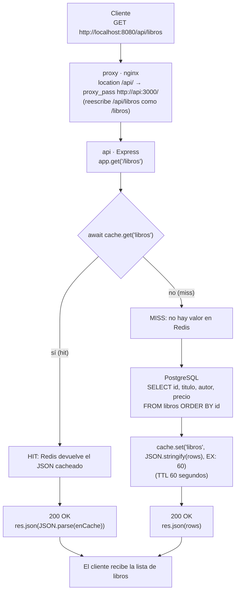
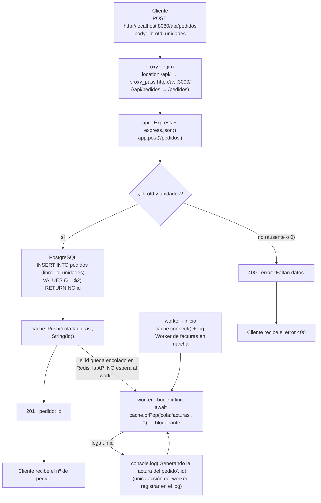

# Recorrido de una petición — tienda-libros

Diagramas Mermaid del recorrido de `GET /api/libros` y `POST /api/pedidos`,
cotejados con `api/src/server.js`, `worker/worker.js` y `nginx/default.conf`.

## 1. GET /api/libros (con caché Redis)

## 2. POST /api/pedidos (cola de facturas + worker)

## Cotejo con el código (comprobaciones)

- `GET /api/libros` lee **primero** la caché (`cache.get('libros')`) y solo consulta PostgreSQL si no hay valor; al responder desde la caché no se refresca el TTL.
- En el *miss*, el `SELECT` es exactamente `id, titulo, autor, precio FROM libros ORDER BY id` y el resultado se guarda con `EX: 60` (60 s).
- `POST /api/pedidos` usa `express.json()` para leer el body; si `libroId` o `unidades` son falsy devuelve **400** sin tocar la base de datos.
- El `INSERT` devuelve el `id` (`RETURNING id`), que se encola como texto en `cola:facturas` con `lPush`, y la API responde **201** sin esperar al worker.
- El `worker` arranca conectando a Redis, hace `brPop('cola:facturas', 0)` (0 = espera bloqueante indefinida) y por cada id solo escribe un `console.log`; después vuelve al bucle.
